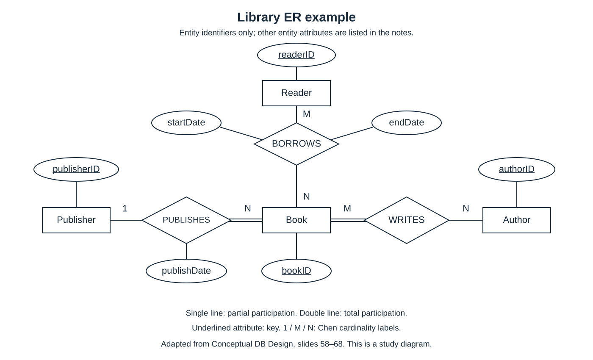

# 02 ER 概念建模：中文学习笔记

CSC5041 · 第一次课堂测验复习 · 2026-10-19

## 阅读说明与学习目标

本篇接续 [01 数据库基础](01_database_fundamentals_zh.md)，对应教学计划第 1 页 Week 2，以及 Tutorial 1 第 1 页 Question 1(a)–(b)。主要依据教师 [Week 1B - Conceptual DB Design.pptx](../../slides/Week%201B%20-%20Conceptual%20DB%20Design.pptx)，下文“第 x 页”均指该文件的第 x 张幻灯片。

学完后，应能从文字需求识别实体、属性、键与关系，判断弱实体，区分基数和参与约束，并用课堂符号画出 ER 图。关系模型的完整性约束留到 03，系统的 ER-to-relational mapping 留到 04。本篇中的解释性补充与自编例子不代表新增考试要求。

课件第 70 页明确要求：**“You must use the notation in the lecture for this course.”** 本篇使用课件的 Chen 风格符号，不用乌鸦脚符号替代。

## 1. ER 模型解决什么问题？

来源：第 2–10、54–56、69–70 页。

ER（Entity-Relationship）模型把应用需求组织为**实体、属性、关系及约束**，属于概念设计。

```text
应用需求 → 识别事物及其联系 → ER 图与约束说明
                                  ↓ 后续 04
                            关系模式及主外键
```

例如，“每本书必须由一个出版社出版”包含两个实体类型 Book、Publisher，一个关系 PUBLISH，以及“每本书恰好一个出版社”的约束。只画两个框再连线，会遗漏业务规则。

概念设计首先回答“需要表达什么”。本篇不从 SQL 建表语句或索引开始，也不把所有外键直接画成 ER 属性。

## 2. 实体、实体类型与实体集

来源：第 10–14、24–27 页。

| 概念 | 含义 | 例子 |
|---|---|---|
| 实体 Entity | 可以被区分的具体对象或概念对象 | 学号为 S01 的学生 Amy |
| 实体类型 Entity type | 定义一类实体共同的属性和结构 | Student，有 sid、name 等属性 |
| 实体集 Entity set | 某时刻该类型的实体集合 | 当前登记的全部学生 |
| 属性 Attribute | 描述实体或关系的性质 | 学生姓名、选课成绩 |
| 域 Domain / value set | 属性允许取得的值的集合 | 某属性允许的日期值 |

实体类型对应结构，实体集对应当前内容，可联系 01 的 schema / instance 理解。实体不必是物体，课程、账户、预约也可以建模为实体。

**怎样判断实体还是属性？** 看需求是否需要独立识别它、记录它自己的性质，并让它参与关系。例如只记录出版社名称时可以考虑一个属性；若要记录出版社编号、名称及其出版的多本书，Publisher 更适合成为实体类型。不能仅凭“它是名词”就决定画实体框。

## 3. 属性类型：先区分三个维度

来源：第 14–23、27–28 页。

| 维度 | 类型 | 含义与例子 |
|---|---|---|
| 能否按业务含义拆分 | 简单/原子 Simple / atomic | 当前设计不再拆分，如 salary |
| 能否按业务含义拆分 | 复合 Composite | 可拆为有独立含义的部分，如 address(city, street, postcode) |
| 每个实体同一时刻有几个值 | 单值 Single-valued | 每个学生只有一个 dateOfBirth |
| 每个实体同一时刻有几个值 | 多值 Multivalued | 一个学生可有多个 phoneNumber |
| 值从哪里来 | 存储 Stored | 直接保存 dateOfBirth |
| 值从哪里来 | 派生 Derived | 根据 dateOfBirth 和参考日期计算 age |

这些不是六个互斥类别。例如 address 可以是**单值且复合**；若一个人允许登记多个地址，address 也可以是**多值且复合**。课件第 15 页将多值属性与 simple 对照；学习时应分别判断“能否拆分”和“有几个值”，不能把 simple 与 single-valued 当同义词。

### 复合属性与多值属性

```text
复合：一个地址 = (city, street, postcode)
多值：多个电话号码 = {130..., 131...}
```

复合属性的分支表示**组成部分**，多值属性的双椭圆表示**值的数量可以多于一个**。若应用只把地址作为整体使用，课件第 21 页指出可以不拆分；是否拆分取决于需要支持的操作。

### 存储与派生

年龄依赖出生日期和参考日期。每年手动修改 age 容易使它与出生日期矛盾，因此本课概念模型把 age 作为派生属性，把 dateOfBirth 作为存储属性。这里讨论概念含义，不规定真实产品必须采用哪种缓存实现。

### 缺失值 NULL

课件第 28 页用 NULL 表示未知或不适用的属性值。例如身高尚未知、某人没有大学学位。NULL 不等于数字 0，也不等于已知的空字符串。SQL 中怎样比较 NULL 留到 06。

## 4. 键：唯一性和最小性要分开检查

来源：第 29–32 页。

| 类型 | 定义 |
|---|---|
| 超键 Superkey | 能唯一识别该类型实体的一组属性，允许含多余属性 |
| 候选键 Candidate key | 最小超键：去掉任何一个属性后，都不再保证唯一 |
| 主键 Primary key | 设计者从候选键中选定的一个 |
| 复合键 Composite key | 由多个属性组成的键 |

**最小 minimal 不等于属性数最少 minimum**：一个类型可以同时有单属性候选键和双属性候选键，只要每个候选键内部都没有多余属性。

**自编例子**：假定 Student 中 sid 唯一，email 也唯一。

- `{sid}`、`{email}` 都是候选键；可以选 `{sid}` 为主键。
- `{sid, name}` 是超键，不是候选键，因为 name 多余。
- 即使当前三名学生姓名互不相同，也不能据此断定 `{name}` 是键。键必须在需求允许的所有合法状态下唯一。

复合键中的每个属性不需要单独唯一。例如在“编号只在本地区内唯一”的前提下，`{regionCode, localNumber}` 可共同识别一个对象。不要因为它有多个属性，就误画成多值属性。

如果自然属性不能可靠地区分对象，可以引入人工标识符；但“添加 ID”本身不能保证其他业务约束已表达完整。

## 5. 强实体、弱实体与部分键

来源：第 33–35 页；结合 Tutorial 1 Question 1(a) 的局部编号要求。

| 概念 | 判断要点 |
|---|---|
| 强实体 Strong entity | 有自身的键，可独立识别 |
| 弱实体 Weak entity | 缺少自身完整的键，需要所有者的标识和自身部分键一起识别 |
| 所有者实体 Owner entity | 提供识别弱实体所需的上下文 |
| 部分键 Partial key / discriminator | 在同一个所有者范围内区分弱实体，不保证跨所有者唯一 |
| 标识关系 Identifying relationship | 将弱实体与其所有者联系起来的关系 |

课件第 34 页“partially unique”的措辞应理解为**唯一性只在某个所有者范围内成立**，而不是“只能识别实体的一部分属性”。

### 一个两层弱实体例子

以下据 Tutorial 1 的编号规则解释，不是整题答案：

```text
Owner：ownerID 全局唯一
  └─ Pet：petNo 只在该 Owner 内唯一
       └─ Treatment：treatmentNo 只在该 Pet 内唯一

Pet 的完整标识       = (ownerID, petNo)
Treatment 的完整标识 = (ownerID, petNo, treatmentNo)
```

因此 Pet 的部分键是 petNo；Treatment 的部分键是 treatmentNo。Treatment 的直接所有者 Pet 本身也是弱实体，识别时需要沿所有者链取得完整上下文。

本例每个 Pet 恰好属于一个 Owner，每个 Treatment 恰好属于一个 Pet；弱实体在自己的标识关系中**全参与**。但不能据此推断所有所有者都必须拥有弱实体：Tutorial 1 要求每个 Owner 至少有一只 Pet，却没有要求每只 Pet 必须接受 Treatment。

**课件措辞辨析**：“弱实体没有自己的主键”指缺少**自身独立的完整键**，不表示后续映射出的表不能有主键；它可以使用“所有者键 + 部分键”的组合，04 再展开。

**不要仅凭依赖关系判弱实体。** 一个员工必须在部门工作，但若 empID 已能独立识别员工，员工仍可为强实体。关键是识别是否依赖所有者。

## 6. 关系、关系属性与角色

来源：第 38–42、48–53 页。

关系类型描述实体之间的联系；关系实例是一组具体参与者。例如 ENROLLED_IN(Student, Course) 是关系类型，“S01 选修 C01”是一个关系实例。

### 属性应挂在哪里？

第 48 页的 WORKS_ON 例子中，fraction 表示某位研究者投入某个项目的时间比例：

```text
(Researcher R1, Project P1) → fraction = 0.4
(Researcher R1, Project P2) → fraction = 0.6
```

fraction 描述**特定研究者与特定项目的组合**，应挂在 WORKS_ON 关系上。只挂在 Researcher 上无法区分项目，只挂在 Project 上无法区分研究者。类似地，借阅开始日期通常描述一次借阅联系。

### 同一对类型可以有多个关系

Tutorial 1 中 Clinic 与 Veterinarian 既有 WORKS_AT，又有 MANAGES。前者表示工作归属，后者表示管理职责，不能合成一条没有名称的线。

“管理者必须在该诊所工作”还要求 **MANAGES 中的配对必须也是 WORKS_AT 中的配对**。仅画两个关系并分别标基数，不能完整表达这条跨关系约束，应附文字说明。

### 角色与关系的度

二元关系有两个参与角色，三元关系有三个。课件第 50 页给出 Researcher、Student、Course 的三元示意；第 53 页让同一 Person 类型分别以 Student 和 Researcher 角色参与。

**解释性补充**：角色数不一定等于不同实体类型数。例如 EMPLOYEE 通过 supervisor、subordinate 两个角色参与 SUPERVISES，仍是二元自关联。画同类型多次参与的关系时，应标角色名。

课件第 52 页建议初学者尝试二元表示，这是建模检查的启发，**不是任意三元关系都能无损拆成三个二元关系的定理**。拆分前应检查能否恢复原来“哪三者共同关联”的信息。本篇重点仍是二元关系。

## 7. 基数约束：问两边的“最多”

来源：第 43–45 页。

对于二元关系 A—R—B，分别固定一个 A、一个 B，询问它最多关联多少个对方实体。

| A:B 的基数比 | 一个 A 最多对应多少 B？ | 一个 B 最多对应多少 A？ |
|---|---|---|
| 1:1 | 1 | 1 |
| 1:N | 多个 | 1 |
| M:N | 多个 | 多个 |

**自编例子**：一个 Department 可以有多名 Employee，每名 Employee 最多归属一个 Department，故 Department:Employee 为 1:N。

课件 Chen 标法是：`Department — 1 — WORKS_FOR — N — Employee`。**Department 框旁的 1 不是“每个部门最多一个员工”**；它表示相对于一名 Employee，关联的 Department 最多为 1。应先写两句自然语言，再标两端数字，避免反向理解。

第 44–45 页的例子同理：一项 Grant 只支持一个 Project，一个 Project 可由多项 Grant 支持，所以 Project:Grant = 1:N；若按 Grant:Project 的顺序写则为 N:1。

`N`、`M` 表示允许多个，不是要求当前恰好存在 N 个，也不表示必须至少两个。**1:N 不能独自表达“每个员工一定有部门”。**

## 8. 参与约束：再问每边的“至少”

来源：第 46–47 页；符号见第 57 页。

| 参与约束 | 对该类型中的每个实体的要求 | 课堂符号 |
|---|---|---|
| 全参与 Total participation | 至少参加一次该关系 | 实体与关系间双线 |
| 部分参与 Partial participation | 允许不参加，即最少 0 次 | 单线 |

部分参与不是“必须有一些实体不参加”，而是**允许有实体不参加**。即使当前每个人都参加，也不能据此认定规则要求全参与。

将最小值和最大值合起来更容易检查。以下 `(min,max)` 是辅助阅读记号，写在文字表里；正式图仍使用课堂的数字和单双线。

| 需求用语 | 每个所讨论实体的参与次数 |
|---|---|
| zero or one / at most one | (0,1) |
| exactly one | (1,1) |
| zero or more | (0,N) |
| one or more / at least one | (1,N) |

例如“每个员工必须且只能在一个部门工作；每个部门可以暂时没有员工”：Employee 是 `(1,1)`，Department 是 `(0,N)`。因此 Department:Employee = 1:N，Employee 全参与、Department 部分参与。

**注意记号方向**：上表某实体的 `(min,max)` 表示“这个实体能关联多少个对方”，与 Chen 基数数字标在图哪一端不是同一阅读规则，不要机械照抄位置。

## 9. 课堂 ER 符号速查

来源：第 35–37、45、47、57 页，已查看原图。

| 要表达什么 | 符号 |
|---|---|
| 普通/强实体类型 | 单矩形 |
| 弱实体类型 | 双矩形 |
| 普通关系类型 | 单菱形 |
| 标识关系 | 双菱形 |
| 普通属性 | 单椭圆 |
| 键属性 | 属性名实线下划线；复合键需标出所有组成属性 |
| 部分键 | 属性名虚线下划线，见第 35 页的示意 |
| 多值属性 | 双椭圆 |
| 复合属性 | 从整体属性椭圆连到各组成属性椭圆 |
| 派生属性 | 虚线椭圆 |
| 全参与 / 部分参与 | 双线 / 单线 |
| 基数比 | 关系两端标 1、N 或 M |

双矩形、双菱形、双椭圆、双线有不同含义。**双线表示全参与，不表示多对多；双椭圆表示多值，不表示复合。** 键的下划线也不是派生属性的虚线边框。

## 10. 贯穿例子：从图书馆需求到 ER 图

来源：第 58–68 页。以下重述课件需求并给出学习用重绘；不是新的模拟题。

### 第一步：实体与属性

| 实体类型 | 键 | 其他属性 |
|---|---|---|
| Book | bookID | title、price、availability |
| Reader | readerID | name、phoneNumber、address(street, suburb) |
| Publisher | publisherID | name |
| Author | authorID | name、phoneNumber、dateOfBirth |

需求第 58–60 页没有给 Reader 出生日期，第 62 页分步示例却出现 dob。本篇以完整需求和第 68 页总图为准，不把 dob 加入 Reader；Author 的出生日期则有明确要求。此处暴露的是课件局部不一致，不应静默增加需求。

### 第二步：每条关系都写两个方向

| 关系 | 每个左侧实体关联多少右侧实体？ | 每个右侧实体关联多少左侧实体？ | 基数与参与 | 关系属性 |
|---|---|---|---|---|
| Reader—BORROWS—Book | Reader 可借 0 到多本 Book | Book 可被 0 到多个 Reader 借阅 | M:N；两边部分参与 | startDate、endDate |
| Publisher—PUBLISHES—Book | Publisher 可出版 0 到多本 Book | Book 必须由恰好 1 个 Publisher 出版 | 1:N；Publisher 部分、Book 全参与 | publishDate |
| Author—WRITES—Book | Author 可写 0 到多本 Book | Book 必须由 1 到多个 Author 编写 | M:N；Author 部分、Book 全参与 | 无 |

“一本书可被多个读者借阅”按课件需求理解为数据库记录范围内的联系，不能自行推成同一本实体副本可同时借给多人。

### 第三步：画图并回读



上图为本笔记重绘，**只显示实体的键属性**；其他实体属性见前表。菱形上的日期属于关系。检查 Book 到 PUBLISHES、WRITES 的双线，再检查 BORROWS 两边的单线，可直接区分三组参与要求。

**模型边界（解释性补充）**：普通二元关系实例由参与实体配对确定。如果需要保存同一个 Reader 多次借同一个 Book 的独立历史记录，仅在 Reader—Book 关系上挂日期不足以区分重复事件，应另建 Loan 实体并给出标识规则。课件示意没有完整展开这项历史建模要求；不要把补充当作对原题新增的强制答案。

## 11. 从文字建模的操作顺序

来源：第 54–55、58–70 页；以下为整理后的解题流程。

1. **读完需求再列实体**：给每个候选实体写一句含义，确认哪些对象需要独立识别。
2. **列属性并分类**：标记复合、多值、派生和可缺失信息，找出各实体的键。
3. **检查弱实体**：编号是否只在某个所有者内部唯一？写出所有者、部分键和完整识别链。
4. **逐条命名关系**：同一对类型可以有多个关系；同类型重复参与时标角色。
5. **分别写两个方向的最小/最大数**：由此确定基数与单双线，不能只写一个“1:N”。
6. **放置关系属性**：判断属性描述单个对象，还是一组参与者之间的联系。
7. **补充无法由图完整表达的规则**：例如 MANAGES 配对必须属于 WORKS_AT、时间先后、编号顺序；需求没有说明的地方标明假设。
8. **回读整张图**：把框、线、数字再翻译成自然语言，核对是否遗漏或增加了约束。

课件第 55 页的四项质量标准是 correctness、completeness、consistency、readability。不同设计可以合理，但必须准确、完整、一致且可读；不能用“没有唯一最佳答案”掩盖漏约束。

## 12. 易混点速查

| 容易混淆 | 正确区分 |
|---|---|
| Entity / entity type / entity set | 某个对象 / 一类对象的结构 / 当前这一类对象的集合 |
| Simple / single-valued | 能否按含义拆分 / 同一时刻是否只有一个值 |
| Composite attribute / composite key | 属性由若干部分组成 / 若干属性共同识别实体 |
| Composite / multivalued | 一个值有多个组成部分 / 一个实体可有多个值 |
| Superkey / candidate key | 唯一即可 / 唯一且没有多余属性 |
| Partial key / full identifier | 所有者范围内唯一 / 连同所有者上下文完整识别 |
| 弱实体 / 必须依赖其他实体存在 | 弱实体的识别依赖所有者；只有存在依赖不足以判弱 |
| Cardinality / participation | 最多关联多少个 / 是否必须至少关联一个 |
| Double line / double oval | 全参与 / 多值属性 |
| Entity attribute / relationship attribute | 描述单个对象 / 描述参与者之间的联系 |
| ER relationship / relational relation | 概念模型的联系 / 关系模型中的关系（表），不要仅因都译成“关系”而混淆 |

## 13. 复习清单与英文表达

以下是自我复习目标，不是正式模拟测试，也不代表官方分值。

- [ ] 区分实体、实体类型和实体集，并各举一个例子。
- [ ] 对给定属性分别判断复合性、多值性和派生性。
- [ ] 解释候选键的“最小”为何不等于“属性数最少”。
- [ ] 给出弱实体的所有者、部分键、标识关系和完整标识。
- [ ] 对每条关系写出两个方向的最少与最多参与数。
- [ ] 正确使用键下划线、双矩形、双菱形、双椭圆、单双线。
- [ ] 说明为什么时间比例、借阅日期等可能是关系属性。
- [ ] 把图书馆图回读成需求，并识别重复借阅历史的模型边界。
- [ ] 对无法从题面确定的约束明确写假设，不自行当成已知。

可用于英文简答的表达：

> An entity type describes a collection of entities that share the same attributes.

> A candidate key is a minimal superkey: no proper subset is still a superkey.

> A weak entity is identified by its owner's identifier together with its partial key.

> Cardinality constrains the maximum number of related entities; participation specifies whether every entity must participate.

> Total participation requires every entity of that type to participate in at least one instance of the relationship.

> The attribute belongs to the relationship because its value describes a particular combination of participating entities.

## 来源与整理记录

- 教师课件：[Week 1B - Conceptual DB Design.pptx](../../slides/Week%201B%20-%20Conceptual%20DB%20Design.pptx)，共 70 页；已读取文字，重点查看第 35–36、45、47、51、53、57、68 页图示。图书馆例子源于第 58–68 页，SVG 是学习用重绘，并省略非键实体属性。
- 范围依据：[CSC5041_Teaching_Plan.pdf](../../syllabus/CSC5041_Teaching_Plan.pdf)，第 1 页 Week 2、第 2 页 Tutorial 1；参考题面：[Tutorial1.pdf](../../slides/Tutorial1.pdf)，第 1 页 Question 1(a)–(b)。本篇未给出完整 Tutorial 答案或模拟卷。
- 对属性分类、弱实体部分键、关系角色、三元拆分及重复借阅边界的解释已在相应段落标明；不把解释性补充冒充教师原句。
- 整理者：Codex 主会话。双语结构、相对链接与来源页码已自查；独立 Reviewer 结论以本轮交付消息为准。无代码/实验任务，运行验证 N/A；不创建 submission，教师原件未修改。
- 输入版本 SHA-256：ER 课件 `1f2bc2b2242208b0d3f0c650341521c65cba833cffe5da82fc27d0ddef7fc734`；Tutorial 1 `316e8b6bb9581a5ecae3fb2f449e395a4ea8a19b4ee16c4191fc20a6079d2c44`；syllabus 教学计划 `31380a7fe6504e46541b6db0bb2f24859c69188bfeb9681dca73354ebeb68295`。这些是本轮读取版本，不沿用 01 的旧哈希。
- 下一步：按用户指示整理 03 关系模型与完整性约束；全部笔记完成后再依据两套 Tutorial 编写两套英文练习题。
