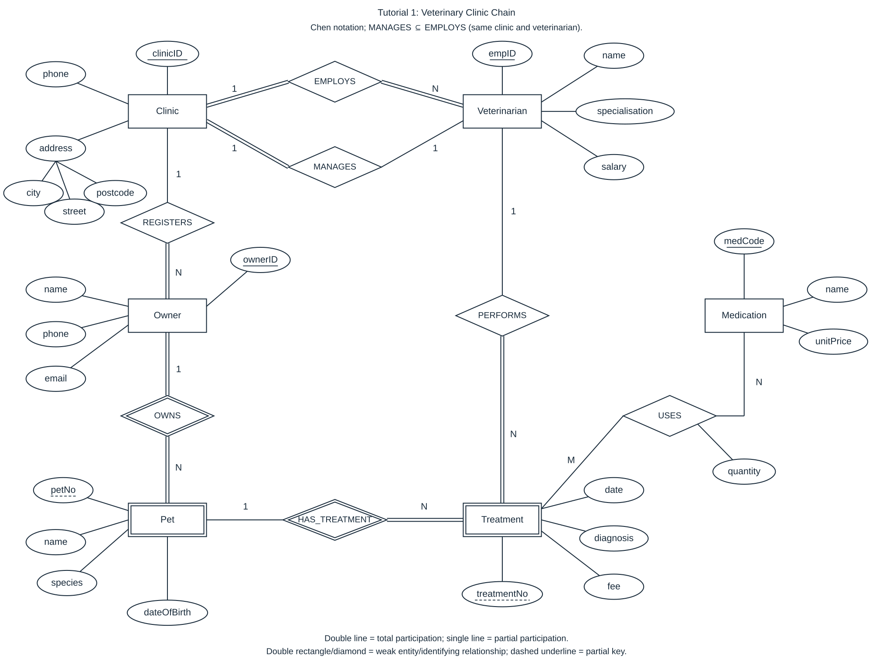

# Tutorial 1 — Compact Answers

[Question sheet](../../slides/Tutorial1.pdf), p. 1, Q1(a)–(d). Model answers, not an official marking scheme.

## Q1(a) Entities, attributes and keys

| Entity | Attributes | Full identifier |
|---|---|---|
| Clinic | clinicID, address(city, street, postcode), phone | clinicID |
| Veterinarian | empID, name, specialisation, salary | empID |
| Owner | ownerID, name, phone, email | ownerID |
| Pet (weak) | petNo, name, species, dateOfBirth | (ownerID, petNo) |
| Treatment (weak) | treatmentNo, date, diagnosis, fee | (ownerID, petNo, treatmentNo) |
| Medication | medCode, name, unitPrice | medCode |

| Weak entity | Partial key | Owner entity | Identifying relationship |
|---|---|---|---|
| Pet | petNo | Owner | OWNS |
| Treatment | treatmentNo | Pet | HAS_TREATMENT |

## Q1(b) Relationships and ER diagram

`(min,max)` counts counterparts for one entity on that side; `T/P` = total/partial participation.

| Relationship (left : right) | Ratio | Left | Right |
|---|---|---|---|
| Clinic — EMPLOYS — Veterinarian | 1:N | (1,N), T | (1,1), T |
| Clinic — MANAGES — Veterinarian | 1:1 | (1,1), T | (0,1), P |
| Clinic — REGISTERS — Owner | 1:N | (0,N), P | (1,1), T |
| Owner — OWNS — Pet | 1:N | (1,N), T | (1,1), T |
| Pet — HAS_TREATMENT — Treatment | 1:N | (0,N), P | (1,1), T |
| Veterinarian — PERFORMS — Treatment | 1:N | (0,N), P | (1,1), T |
| Treatment — USES — Medication | M:N | (0,N), P | (0,N), P |

```text
MANAGES ⊆ EMPLOYS                    [pairs ordered as (clinicID,empID)]
USES has relationship attribute quantity.
```

Assumptions: unspecified participation is partial; a pet may have zero treatments; one USES row per treatment–medication pair; equal-date treatments are allowed.



Single/double lines = partial/total; double rectangle/diamond = weak entity/identifying relationship; solid/dashed underline = key/partial key. Clinic's MANAGES link is total; Veterinarian's is partial.

## Q1(c) Relational schema

Underlined attributes form each primary key; `*` marks foreign-key attributes. Composite foreign keys are grouped below.

- Clinic(<u>clinicID</u>, city, street, postcode, phone, managerID*)
- Veterinarian(<u>empID</u>, name, specialisation, salary, clinicID*)
- Owner(<u>ownerID</u>, name, phone, email, clinicID*)
- Pet(<u>ownerID</u>*, <u>petNo</u>, name, species, dateOfBirth)
- Treatment(<u>ownerID</u>*, <u>petNo</u>*, <u>treatmentNo</u>, date, diagnosis, fee, empID*)
- Medication(<u>medCode</u>, name, unitPrice)
- Uses(<u>ownerID</u>*, <u>petNo</u>*, <u>treatmentNo</u>*, <u>medCode</u>*, quantity)

```text
Clinic.managerID                 → Veterinarian.empID
Veterinarian.clinicID            → Clinic.clinicID
Owner.clinicID                   → Clinic.clinicID
Pet.ownerID                     → Owner.ownerID
Treatment.(ownerID,petNo)        → Pet.(ownerID,petNo)
Treatment.empID                  → Veterinarian.empID
Uses.(ownerID,petNo,treatmentNo)  → Treatment.(ownerID,petNo,treatmentNo)
Uses.medCode                    → Medication.medCode

UNIQUE(Clinic.managerID)
NOT NULL: Clinic.managerID, Veterinarian.clinicID,
          Owner.clinicID, Treatment.empID
All primary-key components are NOT NULL.

∀c ∈ Clinic:
  Veterinarian[c.managerID].clinicID = c.clinicID
  [same-clinic manager: additional cross-relation check]
```

| ER relationship | Representation |
|---|---|
| EMPLOYS, REGISTERS | 1:N → foreign key on N side |
| MANAGES | 1:1 → Clinic.managerID + UNIQUE + NOT NULL |
| OWNS, HAS_TREATMENT | Identifying → owner key in weak-entity PK/FK |
| USES | M:N → separate Uses relation; quantity belongs here |
| PERFORMS | 1:N → Treatment.empID |

## Q1(d) Two constraints beyond keys/foreign keys alone

**1. Every owner has at least one pet.**

```text
∀o ∈ Owner, ∃p ∈ Pet: p.ownerID = o.ownerID
```

Mechanism: global assertion / transaction-end constraint trigger.

**2. Treatment numbers respect chronological order within each pet.**

```text
∀t,u ∈ Treatment:
  (t.ownerID,t.petNo) = (u.ownerID,u.petNo)
  ∧ t.treatmentNo < u.treatmentNo
  ⇒ t.date ≤ u.date
```

Mechanism: assertion / trigger checking affected histories on INSERT/UPDATE.

*Same-clinic management in (c) also needs an extra check; alternatively, declare UNIQUE(empID,clinicID) on Veterinarian and add FK Clinic(managerID,clinicID) → Veterinarian(empID,clinicID).*

---

Source: Tutorial1.pdf p. 1; mapping/notation: [Lecture2A.pptx](../../slides/Lecture2A.pptx), slides 3, 33–55. Question-sheet SHA-256: `316e8b6bb9581a5ecae3fb2f449e395a4ea8a19b4ee16c4191fc20a6079d2c44`. SQL execution: N/A; schemas/constraints are declarative answers.
